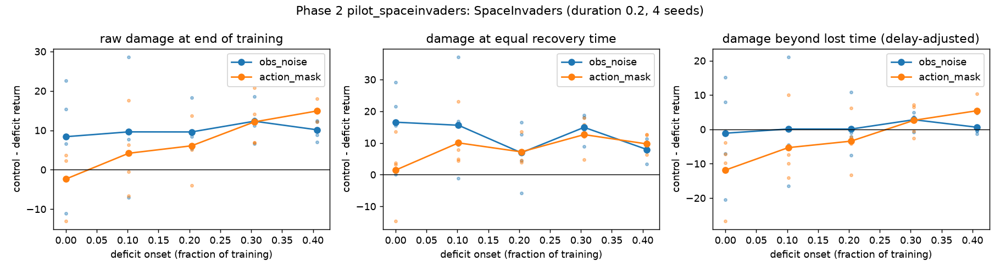

# Where Does Early Damage Live? Weight, Optimizer, and Data Scars in Reinforcement Learning

Research code and reproducible log for a TMLR submission.

**Question.** Deep networks have *critical learning periods*: a temporary deficit early in training
causes permanent damage, while the same deficit later is harmless (Achille et al., 2019).
In RL the agent produces its own training data, so lasting damage could be stored in three places:

| Carrier | What it is | How we test it |
|---|---|---|
| **Weight scar** | damaged network parameters | transplant clean vs. damaged params |
| **Optimizer scar** | damaged Adam moments (m, v, step count) | transplant clean vs. damaged optimizer state |
| **Data scar** | damaged replay buffer / behaviour policy | transplant clean vs. damaged buffer (off-policy) or swap the behaviour policy (on-policy) |

The core experiment is **state surgery**: when the deficit ends, we build hybrid agents from a
*damaged* run and a *clean* run, using all 2×2×2 combinations of {weights, optimizer, data}, and measure final performance.

## Repo layout
```
configs/            YAML configs (base + one file per deficit type)
src/rled/           library code
  deficits.py       deficit windows: onset/duration schedule + deficit transforms
  surgery.py        trainer-state composition (the 2x2x2 transplant)
  metrics.py        plasticity diagnostics (dormant ratio, feature rank, ...)
  provenance.py     records git hash, config, seed, env for every run
  agents/           PQN/DQN (off-policy) and PPO (on-policy), PureJaxRL-style
scripts/            entry points (sweeps, surgery runs, analysis)
tests/              unit tests (run before every experiment commit)
docs/               literature review, design notes
runs/               run registry (small JSON manifests only, committed)
results/            large outputs (git-ignored; summaries go in results/summary/)
LOG.md              dated research log: every decision, run, and result
```

## Reproducibility rules
1. Every run writes a manifest to `runs/` with its git commit, config, seed, and package versions (`rled.provenance`).
2. Runs from a dirty working tree are refused unless `--allow-dirty` is passed, and that flag is recorded in the manifest.
3. Every decision, run batch, and result gets a dated entry in `LOG.md`.
4. Statistics use `rliable` (IQM + stratified bootstrap 95% CIs); never report a mean over fewer than 10 seeds.

## Setup
```bash
python -m venv .venv && source .venv/bin/activate
pip install -e ".[dev]"            # CPU
pip install -e ".[dev,gpu]"        # CUDA 12 JAX
pytest -q
```

## Status
Phase 0: scaffold and literature review. See `LOG.md`.

## Status and results so far (2026-10-11)

Full details, tables and caveats are in [`LOG.md`](LOG.md). Every number traces to a manifest in `runs/` and a summary in `results/summary/`.

**Phase 1: baselines (PPO, 2x128 MLP, CPU-only)**
- Breakout-MinAtar is bimodal: most seeds plateau at about 7 (the gymnax reference is 28), and gamma 0.999 does not fix it. Not used as the primary env.
- Primary env: **SpaceInvaders-MinAtar** (smooth and seed-consistent; about 81 at 2M steps). Replication env: Asterix-MinAtar.
- Same-seed reruns are bit-identical (a prerequisite for state surgery).

**Phase 2 pilot: deficit windows on SpaceInvaders** (duration 20% of 2M steps, onsets 0–40%, 4 seeds)



- `obs_noise` (sigma 1): about 10 points of raw damage at every onset, but about 0 once lost training time is accounted for. No lasting scar.
- `action_mask` (2 of 4 actions): early masking is free; damage grows with onset. Only the latest window exceeds the lost-time null (+5.4 [2.1, 9.0]); a longer-recovery test is pending. The per-seed random mask was a design flaw, to be replaced with fixed "no fire" and "no movement" masks.
- Decision point 2 (a peak-then-fall damage curve) is **not met yet**.
- Methodological note: while the control is still improving, raw final-return damage is confounded with lost time, so we report delay-adjusted damage.
