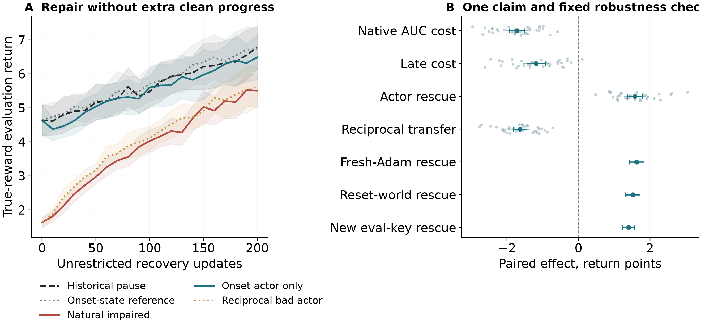

# Actor Checkpoint Restoration in Asterix PPO
## A Reference-Aware Study of Recovery Cost

CPU-scale RL experiments, reproducible results and a TMLR-format manuscript. **Effects are conditional on the reference intervention, future context and finite recovery horizon—not a unique decomposition of naturally encoded damage.**

**[Concise main paper](paper/main.pdf)** · **[Full supplement](paper/supplement.pdf)** · [Primary reproduction guide](docs/primary_asterix_reproduction.md) · [32-row results CSV](results/summary/p14_primary_per_seed.csv) · [Evidence map](docs/headline_inference_map.json)

**Presentation revision:** the main paper now focuses on the reference framework and one Asterix intervention. All historical scientific tables and figures are retained in a separate supplement, with failed/inconclusive primaries still visible in the main evidence hierarchy. [Review response](docs/response_presentation_review.md) · [Research log](LOG.md) · [Availability](docs/result_availability.md).

## One focused result: a past actor checkpoint repairs most beyond-time recovery cost

A separately preregistered **32-seed Asterix PPO confirmation** used entirely new training IDs 1200–1231. Reward signs were flipped for 50 updates, then training was unrestricted for 200 updates. The repair restores **only actor parameters from before impairment**, not the clean fork's extra training progress. The main intervention preserves the natural damaged removal-time critic, Adam state, environment, observations, future RNG and counters; downstream trajectories can diverge.

| Registered primary component | Mean [95% paired-seed CI] | Required mean | Shifted one-sided p |
|---|---|---|---|
| Native historical-pause AUC cost | −1.722 [−1.940, −1.504] | < −0.50 | 6.02 × 10⁻¹³ |
| Late-window cost, +160–200 | −1.187 [−1.444, −0.930] | < −0.30 | 3.32 × 10⁻⁸ |
| Onset-actor-only rescue | +1.580 [+1.371, +1.790] | > +0.50 | 4.79 × 10⁻¹² |
| Reciprocal impaired-actor transfer | −1.636 [−1.828, −1.445] | < −0.50 | 1.39 × 10⁻¹³ |

**One compound claim, not the best of four tests:** all four components were required through their maximum p at α=.01, plus at least 24/32 native-negative and rescue-positive seeds. The criterion passes at **p = 3.319 × 10⁻⁸**; native cost is negative in **32/32** seeds and actor rescue positive in **32/32**.

Actor rollback removes **91.8% of the mean native recovery cost** (paired-bootstrap 95% interval **86.3–97.5%**). This is a ratio of mean intervention effects, not an information allocation. Rescue remains positive with common fresh Adam, a reset training world, and an independently frozen evaluation key.

**Not full restoration:** the repaired-minus-historical residual is −0.141 [−0.246, −0.037]. Its secondary ±.30 practical margin passes, but literal zero is not claimed. The matched-onset-state residual is −0.231 [−0.370, −0.091] and **fails** the same margin (TOST p=.160). A small critic effect under fresh Adam is retained. No failed control is hidden or used to replace the primary.



- [Preregistration, public before target data](prereg/phase14.json) — initial commit `6262b2b`
- [Full primary and robustness analysis](results/summary/p14_single_result-analysis.md)
- [Machine-readable results, every paired seed, source hashes](results/summary/p14_single_result-analysis.json)
- [Release summary and interpretation](docs/phase14_release_summary.md)
- [Direct raw-group/manifest/batch-fingerprint index](docs/p14_primary_artifact_index.json)
- [Runner](scripts/p14_actor_repair.py), [fixed queue](scripts/queue_p14.py), [analysis](scripts/analyze_p14.py), [independent arithmetic audit](scripts/verify_p14.py)

The prior eight-seed Asterix cohort motivated this **selected condition** and is never pooled into the new primary. No primary interim analysis, N expansion, setting/endpoint search or evaluation-key selection occurred. All 32 completed all 11 requested cells. The study ran sequentially on **two CPU cores, no GPU**. It is not a new task added to a generalization success count or proof of irreversible/plasticity loss.

## The paper's two evidence tiers

- **Tier I — same-update gap attribution.** A clean-fork transplant can import progress made while the impaired agent fell behind. Component effects on this gap do not, by themselves, locate harm beyond lost training time.
- **Tier II — pause-reference intervention on detected beyond-time harm.** A direct pre-impairment/onset donor and a historical pause benchmark target a different estimand. The focused Asterix result above belongs here, under its declared natural future context and finite horizon.

The main SpaceInvaders movement setting has historical-pause AUC +1.9 [−0.7, +4.4], n=12: harm worse than −3 is excluded, but equivalence is not established. Its 90% actor allocation concerns Tier I. Recovery AUC cost, a late-window deficit and irreversibility are distinct claims.

Other results retain their own evidence status:

- Matched replay identity is bounded only at the selected **±1** practical margin (TOST p=.0495); ±.75 fails. This is not zero effect at every relevant scale.
- The controlled label-exposure assay has an inconclusive matched primary and does not prove the original buffer-through-learning account.
- Frozen independent-cohort acute+KL prediction worsens point MSE and fails its utility criterion. KL remains a candidate associated diagnostic, not a validated future-failure or causal predictor.
- The older eligible-setting actor count is conditional, not a new-task prevalence estimate. Freeway remains four complete seeds of a planned eight. Unrun studies, reused seed IDs, finite horizons and legacy interim looks are disclosed.
- Only the five Phase-13 primary claims share that phase's Holm family. The focused Phase-14 compound is a separate α=.01 scope, **not retrospective paper-wide error control**.

See [Phase-13 family outcomes](results/summary/p13_confirmatory-analysis.md), [prospective diagnostic failure](results/summary/p13_D_prospective-analysis.md), [fifth-round response](docs/response_round5.md) and the manuscript for all legacy results. Older summaries are historical, not a substitute for the current inference map.

## Reproduce the focused result

The exact installed numerical environment is in [`requirements-repro.txt`](requirements-repro.txt); run manifests record source revisions and package versions. The original study used Python 3.13 on Linux CPU. To avoid memory contention on a 2 GB machine, run **JAX jobs sequentially**, then analysis/figure/TeX jobs after training exits.

```bash
python -m venv .venv
source .venv/bin/activate
pip install -r requirements-repro.txt
pip install -e . --no-deps
pytest -q

# Reanalyse the archived complete n=32 cohort; refuses partial cohorts.
OPENBLAS_NUM_THREADS=1 python scripts/analyze_p14.py
OPENBLAS_NUM_THREADS=1 python scripts/verify_p14.py
python scripts/build_primary_artifact_index.py  # deterministic CSV/index export only
OPENBLAS_NUM_THREADS=1 python scripts/make_p14_result.py
(cd paper && tectonic --reruns 3 main.tex && tectonic --reruns 3 supplement.tex)
```

For a training rerun, reproduce the manifest's exact four-seed groups and source/environment rather than change the batch shape. Example:

```bash
OPENBLAS_NUM_THREADS=1 OMP_NUM_THREADS=1 python -u scripts/p14_actor_repair.py \
  --tag actor-repair-s1200to1203-fresh-reproduction --seeds 1200 1201 1202 1203
```

The paper uses three explicit TeX reruns to obtain stable references with Tectonic 0.15; the default automatic rerun detection can emit a bibliography-consistency warning even with unchanged auxiliary/bibliography hashes. All cited keys and rendered references are checked.

A fresh tag recomputes cells; the original tag may resume archived cells after matching donor fingerprints. Follow the reproduction guide to avoid confusing resumption with a fresh rollout-level recomputation. Full P/C/D donor trees were not archived: available fingerprints cover four-seed batches, not downloadable per-seed checkpoints.

The original queue's wall-clock cutoff was part of its fixed eight-hour execution budget. A later full rerun must explicitly document a **new execution schedule**, without altering the seed list, scientific configuration or inferential rules. Do not use a software-smoke seed as experimental evidence. Resume only after identical donor fingerprints, configuration and overlapping fork evaluations; never silently combine incompatible cells.

## Repository and archive

| Path | Contents |
|---|---|
| `paper/` | Concise main PDF, complete separate supplement, LaTeX and embedded figures |
| `src/rled/` | PPO, PQN (no replay), PQN-R and state-intervention utilities |
| `prereg/` | Public fixed protocols and frozen diagnostic coefficients |
| `scripts/` | Training, fixed queues, analysis, verification and figure generation |
| `tests/` | Software checks; synthetic fixtures never enter scientific inference |
| `runs/` | Committed manifests with seed/configuration/source provenance |
| `results/summary/` | Per-seed curves, analyses and all partial/null outcomes |
| `docs/` | Inference map, availability limitations and review responses |
| `LOG.md` | Chronological decisions, runs, deviations and results |

All surviving 191 NPZ arrays are versioned. Full transient runner-state pickles and some old redundant dumps are **not** archived; [availability notes](docs/result_availability.md) identify regeneration requirements and the four unavailable historical local-only Git objects. New Phase-14 summaries preserve all requested seed-level mean curves, the second evaluation key where specified and exact donor-state fingerprints, not full runner trees.

Statistics follow each registered estimand and family: independent training-seed pairing, explicit practical margins, fixed-N withholding, nominal intervals and declared multiplicity scopes. Some legacy studies are exploratory n=4 or registered n=8; they are not relabelled as large independent replications. See [the hash inventory](docs/result_inventory.json). MIT license.
